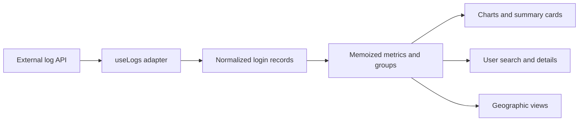

# Authentication Activity Dashboard

**Turn login records into understandable metrics, charts, and user views.**

Next.js 14 · React · TypeScript · Recharts · Tailwind CSS

[Demo link](https://dashboard-three-delta-27.vercel.app/) · [Data adapter](hooks/useLogs.ts) · [Dashboard source](components/Dashboard.tsx)

## Why this project is useful

A stream of login records is difficult to scan directly. This dashboard groups those records into overall activity, authentication methods, user histories, and geographic summaries so a developer can inspect how an application is being used.

## Features

- Login, unique-user, and authentication-method summary cards.
- Interactive activity and authentication-method charts.
- Recent-login tables and geographic distribution views.
- User search by name or email, with a detail view for a selected user.
- Dashboard, analytics, users, and help routes.

## Run locally

From the downloaded source directory, with Node.js/npm available:

```bash
npm install
npm run dev
```

Open [localhost:3000](http://localhost:3000). Build/start scripts are also included:

```bash
npm run build
npm start
```

## Data connection

[`hooks/useLogs.ts`](hooks/useLogs.ts) fetches an external `/all_logs` endpoint configured in source. It expects records containing `name`, `email`, `requester`, `timestamp`, and optional IP information, then derives country and coordinate fields from the requester text.

To use a different service, update that adapter and its request headers for your own API contract. The backend service is not part of this repository. The hook fetches when mounted; it does not maintain a live socket or polling subscription.

## Architecture



## Source guide

| Path | Responsibility |
|---|---|
| [`app/`](app/) | Next.js routes and application layout |
| [`hooks/useLogs.ts`](hooks/useLogs.ts) | Fetching, parsing, grouping, and metrics |
| [`components/Dashboard.tsx`](components/Dashboard.tsx) | Overview cards and charts |
| [`components/Users.tsx`](components/Users.tsx) | Search and per-user activity |
| [`components/Map.tsx`](components/Map.tsx) | Geographic presentation |

The existing demo URL is retained as a project reference. Data availability depends on the external log service; the README does not imply the demo or service is continuously available.
